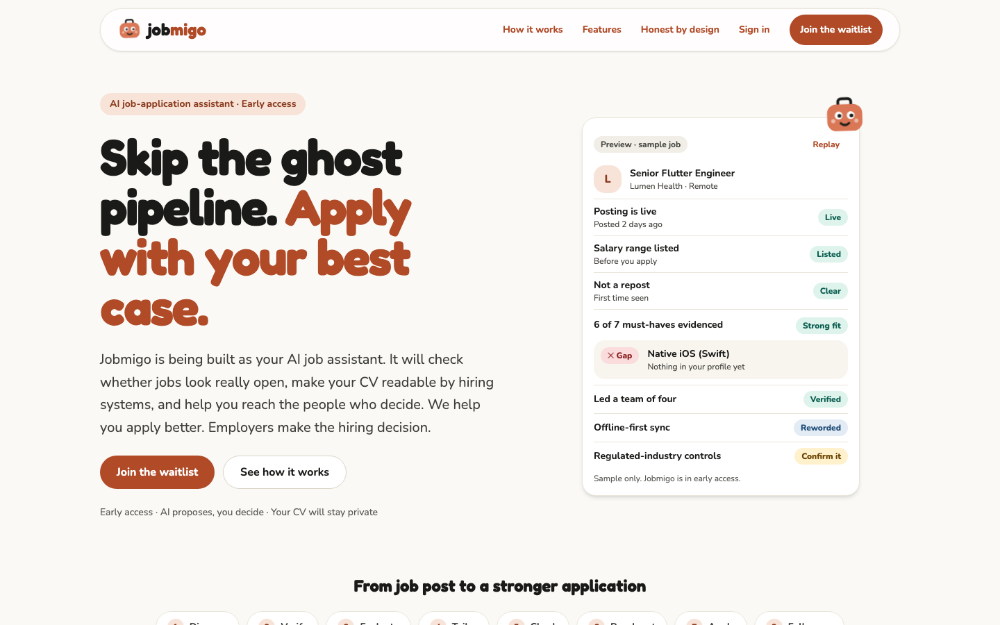
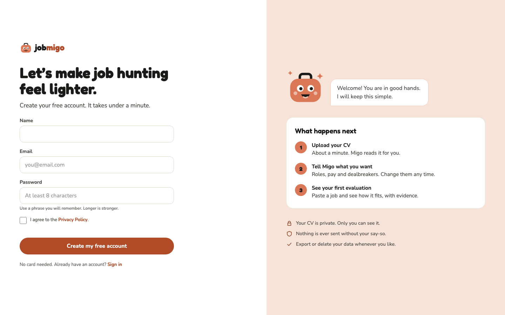
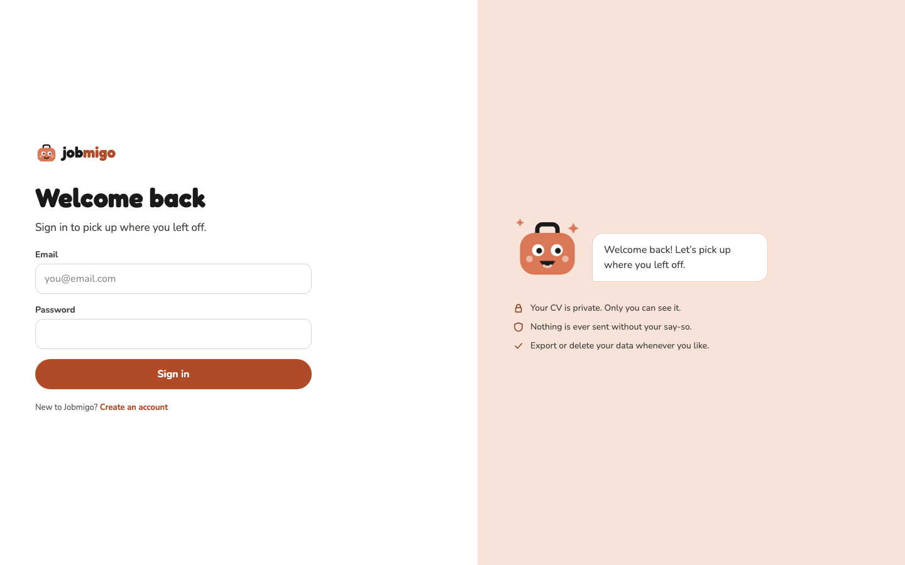
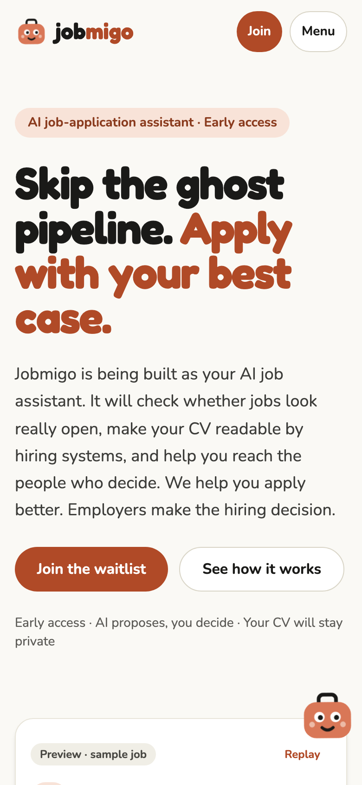
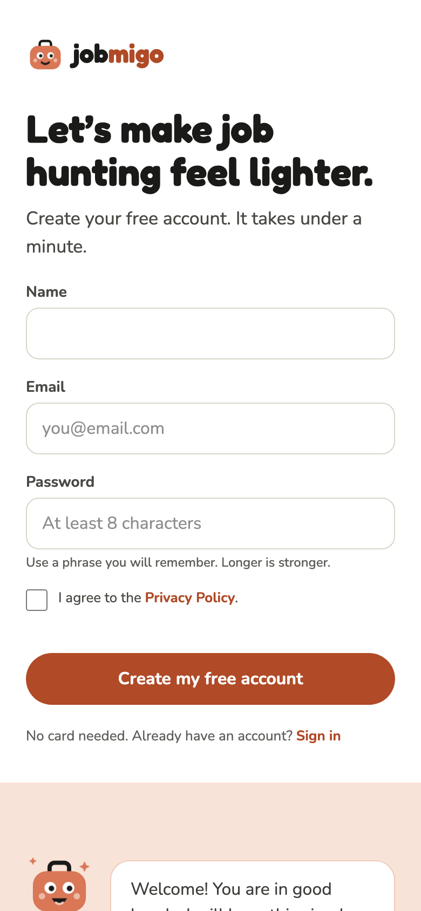
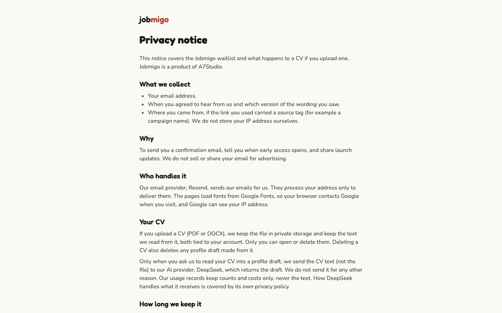
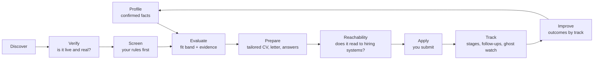
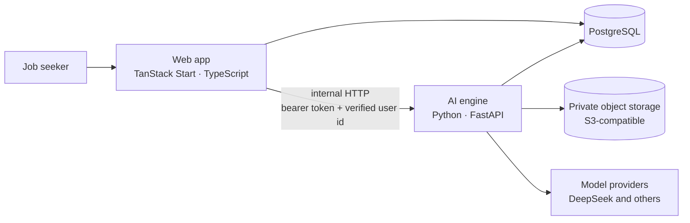
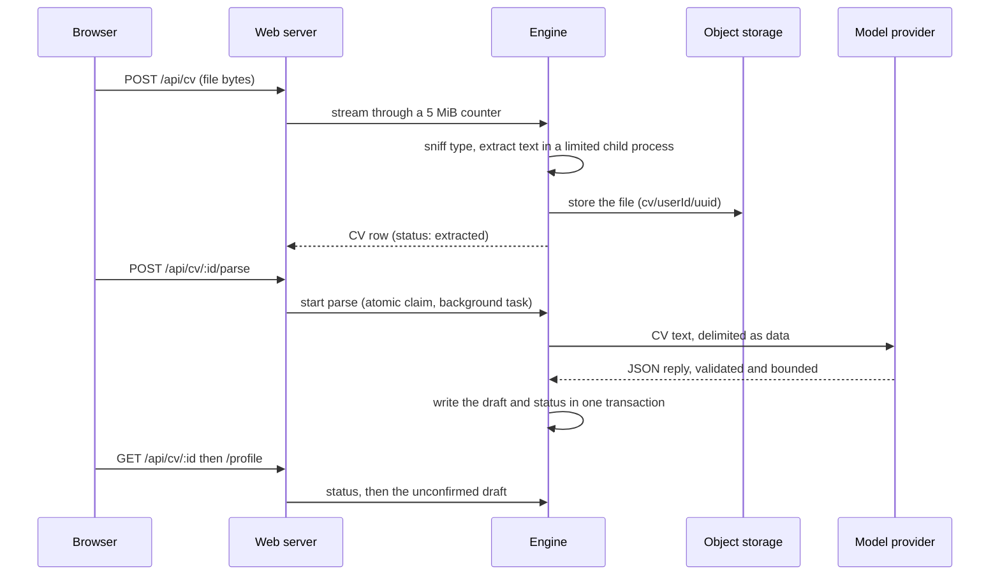

# Jobmigo

An AI job-application assistant for professionals. It helps you decide which few jobs
deserve your time, shows the evidence for that call, and prepares truthful, tailored
applications. It proposes and you decide. No outcome is promised: winning the interview
is up to you.

Jobmigo is the first product of A7Studio. It is **under active development**: the sections
below separate what exists today from what is planned.

## What it looks like today

These are the pages that run now, captured from a local build. The onboarding, profile review,
job evaluation, application kit and board screens are designed but **not built yet**, so they
are not pictured here.

**Homepage** (the demo card is a labelled sample, not a live result)



**Create an account** and **sign in**





**On a phone**

<p>
  
  
</p>

**Privacy notice**



## The problem

For most job seekers the bottleneck is the application itself, not the search:

- **Filtered out.** Hiring software screens CVs before a person reads them, and a CV that
  reads badly to a parser never gets seen.
- **Buried.** Popular roles draw hundreds of applications, so generic ones vanish.
- **Dead jobs.** Many postings are stale, reposted or never real, and the time spent on
  them is lost (the "ghost pipeline").
- **Scattered and repetitive.** Searching, tailoring, tracking and following up live in
  separate tools and spreadsheets.

Existing tools cover one slice, and "AI apply" tools favour volume over quality, which makes
the first three problems worse.

## The solution

Jobmigo tells you which few verified jobs are worth applying to, why, and prepares an
application you can stand behind.

Principles that every feature follows:

- **Never fabricate.** Generated documents reuse only profile facts you have confirmed; any
  new claim is flagged for you.
- **No fake precision.** A job's fit is a band (Strong, Good, Stretch, Poor) with evidence per
  requirement and an explicit "unknown" where the posting is silent. There is no percentage.
- **Legitimate sources only.** No scraping behind logins, no terms-of-service-violating
  automation, no auto-submitting applications.
- **You stay in control.** AI drafts and explains; a human approves every claim and every
  send.
- **Private by default.** A CV is sensitive. It lives in private storage, every row is scoped
  to its owner, and CV text is never logged.

## How it works

The product is organised as a loop, from finding a job to learning from the outcome:



1. **Profile.** You upload a CV. The text is extracted safely, an AI model proposes a
   structured profile (experience, skills, achievements, education), and you review and
   confirm each fact. Only confirmed or edited facts can ever appear in a generated document
   or an evaluation.
2. **Tracks.** You can keep several search tracks (for example mobile engineering, and AI
   engineering), each with its own profile variant, target roles, salary floor, location and
   eligibility rules, must-haves, dealbreakers and a do-not-apply list.
3. **Jobs.** Start by pasting a job link or text. Automatic discovery from public sources is
   a later, premium slice that reuses the same evaluator.
4. **Gates before AI.** Your dealbreakers, do-not-apply list and cached results run as plain
   code first, so no model is paid for to reject something a rule already rejects.
5. **Evaluate.** A cheap model screens; a stronger model evaluates the shortlisted jobs. The
   result is a fit band with the requirement, the evidence from your confirmed facts, the gap,
   and salary and eligibility checks.
6. **Prepare.** Tailored CV, cover letter and answers are written from confirmed facts only,
   fact-checked against your profile, versioned, and exportable.
7. **Reach a person.** A reachability checklist covers readability, headings, title match and
   truthful keyword coverage; research can surface the hiring team from public information.
8. **Track.** A board of stages, notes, interviews and follow-ups, with a nudge for
   applications that have gone silent.

The full workflow map is in [`docs/ai-workflows.md`](docs/ai-workflows.md).

## Architecture

Two services over one PostgreSQL database, plus private object storage.



| Part | Technology | Responsibility |
|---|---|---|
| `web/` | TanStack Start, React, TypeScript, Tailwind, Better Auth, Drizzle, Vitest | UI, sign-up and sessions, validation, authorisation, the public API the browser calls, and the only caller of the engine |
| `engine/` | Python 3.13, FastAPI, Pydantic v2, SQLAlchemy 2 (async), Alembic, httpx, uv | Everything that calls a model or parses a file: AI gateway, CV storage and extraction, profile parsing (evaluation and the application kit come later) |
| PostgreSQL | One database, two schemas | `public` is owned by Drizzle (web data); `engine` is owned by Alembic (CVs, profile drafts, AI cache and usage ledger). The engine holds no foreign keys into `public` |
| Object storage | S3-compatible (RustFS locally) | CV files, reached through short-lived signed links |

Boundaries that matter:

- **The engine has no public port.** Only the web server calls it, with a shared bearer token
  and the user id taken from the verified session. The engine never trusts a user id from a
  browser, and every query filters on it.
- **Files are parsed in isolation.** CV extraction runs in a child process with CPU, memory
  (Linux), wall-clock and output limits, an empty environment, and byte-counted
  decompression, so a hostile PDF or DOCX is bounded rather than trusted. It is bounded, not
  sandboxed: there is no network or syscall filter.
- **One AI gateway.** Models are chosen by tier (cheap, strong) from configuration, prompts are
  versioned, replies are validated against schemas, and every call writes a usage row with
  tokens and cost but never the text.
- **Facts carry a status.** Profile rows are `extracted`, `confirmed` or `edited`; generation
  and evaluation may only cite the last two.

More detail: [`docs/technical-design.md`](docs/technical-design.md),
[`docs/database-design.md`](docs/database-design.md) and
[`docs/python-engine-proposal.md`](docs/python-engine-proposal.md).

### The CV flow, as built



A parse is explicit, retryable from `failed`, and stores a stable failure code (never a
message or model text). Deleting a CV deletes its stored file and its draft.

## Status

| Area | State |
|---|---|
| Public homepage, waitlist with consented email, privacy notice | Built |
| Sign-up and sign-in (Better Auth), per-user scoping, app shell | Built |
| Python engine, AI gateway, per-user cache and usage ledger | Built |
| CV storage, safe text extraction, owner-scoped download and delete (3a) | Built |
| AI parse into an unconfirmed profile draft, engine and web routes (3b) | Built |
| Upload and parse status screen at `/onboarding` (3c) | Built |
| Profile review and confirmation, tracks, job paste, evaluation, application kit, tracking | Planned |
| Automatic discovery, alerts, billing, admin and support | Planned (later slices) |

The ordered feature list is [`blueprint/build-plan.md`](blueprint/build-plan.md); the
distilled source of truth is [`blueprint/context/project-overview.md`](blueprint/context/project-overview.md).

## Running it locally

Needs Node, Docker, and [uv](https://docs.astral.sh/uv/) (which installs Python 3.13 itself).
Copy `.env.example` to `.env` first.

```bash
docker compose up -d db storage      # PostgreSQL (5442) and local object storage (9100)
cd web && npm install && npm run db:migrate
npm run dev                          # http://localhost:3000
```

Start the engine in another terminal (port 8100; set `ENGINE_TOKEN`, at least 32
characters, in `.env`):

```bash
cd engine && uv sync
uv run --env-file ../.env uvicorn engine.main:create_app --factory --port 8100
```

Parsing a CV needs an AI model: set `AI_CHEAP_MODEL` (for example `deepseek/<model-id>`) and
its provider key in `.env`. Without them uploads work and a parse fails with a clear
`ai_not_configured` error.

The full stack in containers: `docker compose up --build`.

### Checks

```bash
(cd web && npm run lint && npm run typecheck && npm run build && npm test) \
  && (cd engine && uv run ruff check . && uv run ruff format --check . && uv run mypy \
      && uv run --env-file ../.env pytest)
```

Commands for the live provider check, object storage tests and the Linux memory-limit
tests are listed in [`AGENTS.md`](AGENTS.md).

## Repository layout

| Path | Contents |
|---|---|
| `web/` | TanStack Start app: routes, server code, Drizzle schema, tests |
| `engine/` | FastAPI engine: AI gateway, CV storage and extraction, migrations, tests |
| `deploy/`, `docs/deploy.md` | Production compose file, Caddy, deploy, backup and restore scripts |
| `docs/` | Technical and database design, AI workflows, engine proposal, reference study |
| `blueprint/` | Plans, build history, and the workflow state the AI-assisted build uses |
| `prototypes/` | Design tokens (`theme.css`) taken from the approved design canvas |

## Privacy

A CV is sensitive data. Files are stored privately and reached through signed links that
last five minutes; every row belongs to one user; filenames, text, storage keys and signed
links are never logged. CV text is sent to the AI provider only when you ask for a parse,
and the privacy notice names that provider. Data export and verified account deletion are
planned and not built yet.
