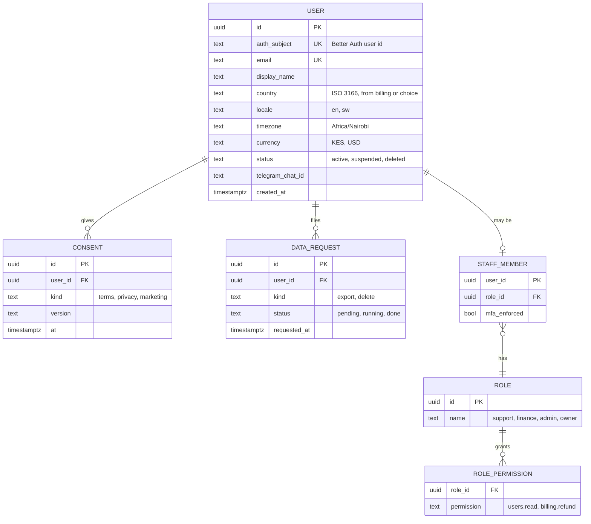
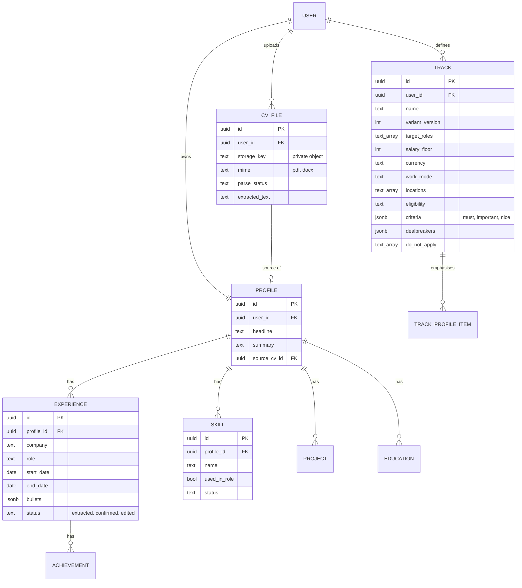
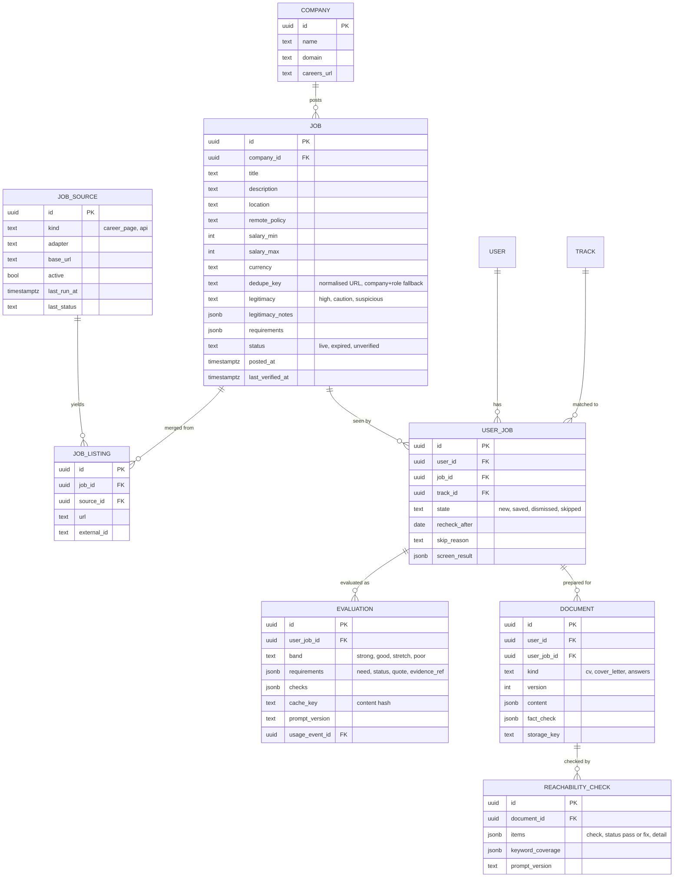
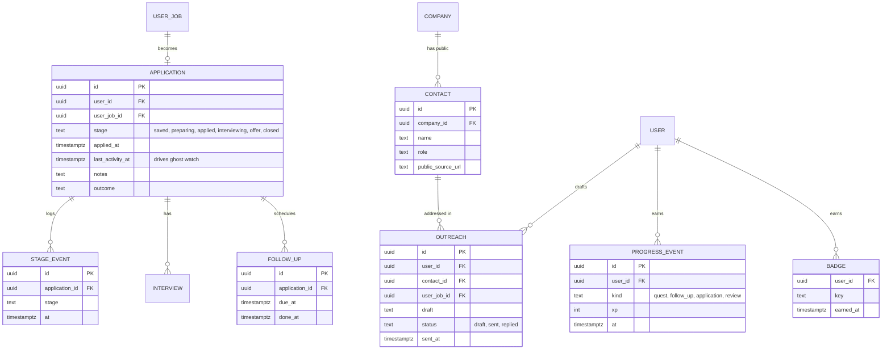
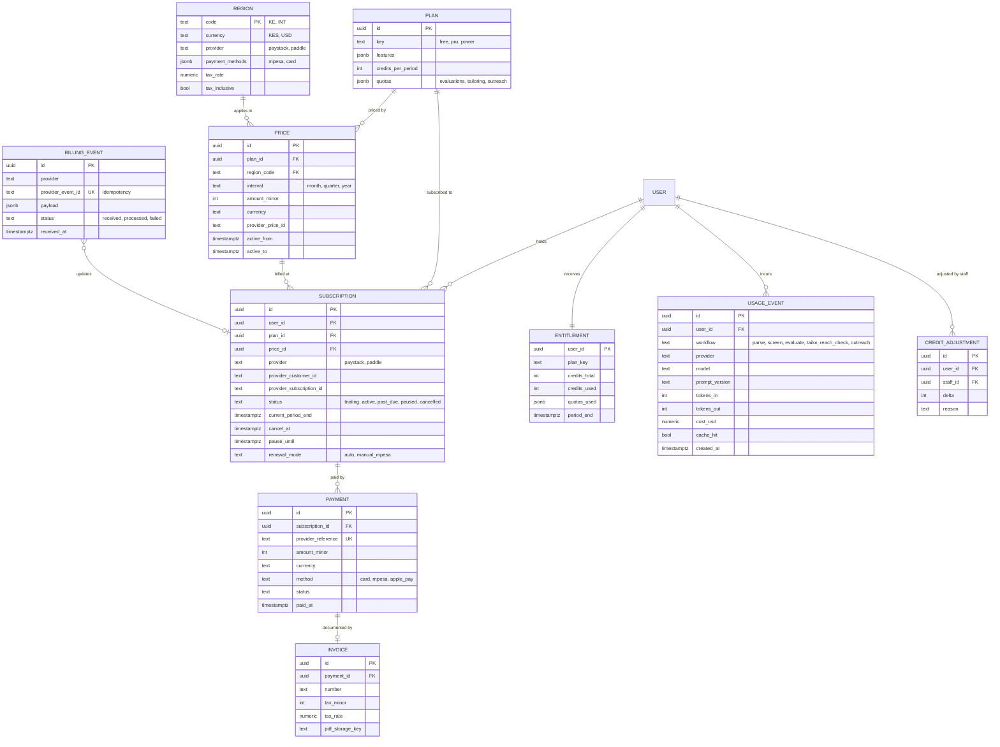
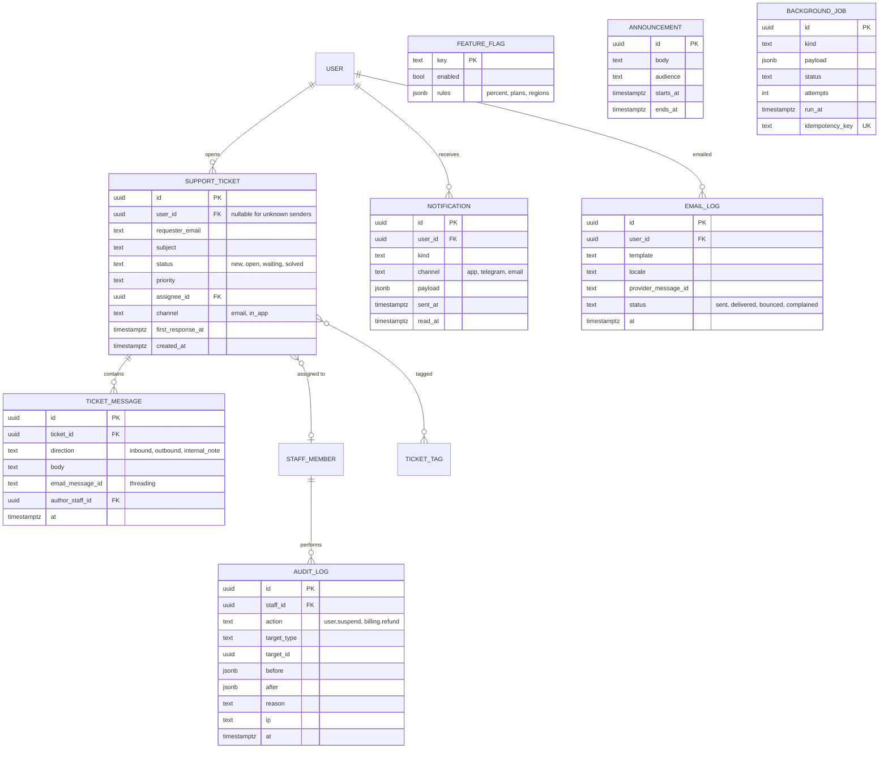

# Jobmigo database design

PostgreSQL, SQLAlchemy 2.x models, Alembic migrations. This document is the
design of record for how data is stored. Field lists are the starting point; the
feature that first uses a table locks its final shape in its spec.

## Conventions

- Primary keys are UUIDs (`id`). Every table has `created_at`; mutable tables also have `updated_at`.
- **Tenant data** (anything derived from a user's CV, preferences, applications or payments) carries `user_id` and is always queried through the owner-scoping helper. **Shared data** (`company`, `job`, `job_listing`, `job_source`, `plan`, `price`) has no `user_id`.
- Defence in depth: Row Level Security is enabled on tenant tables. The API sets `app.user_id` per request; the admin role bypasses it only through the audited admin module.
- Money is stored as integer minor units (`amount_minor`) with an ISO `currency` code. Never floats.
- Enums are Postgres enums or text with check constraints, defined once in the owning module.
- Soft delete only where history matters (`user.status`, `application`). User deletion is a real purge job that removes tenant rows and storage objects.
- No card or mobile-money credentials are stored. Only provider references (customer id, subscription id, payment reference).
- Personal text (CV text, drafts) is never written to logs or analytics.
- Indexes: every foreign key; `(user_id, created_at)` on tenant lists; `job.dedupe_key` unique-ish; `billing_event.provider_event_id` unique for idempotency.

## 1. Identity and access

Sign-in is handled by Better Auth in the web server. It owns five tables, created by Alembic like the rest: `auth_user`, `auth_session`, `auth_account`, `auth_verification` and `auth_jwks` (signing keys). The API never reads them. It trusts a signed token, and `user.auth_subject` holds the Better Auth user id.

## 2. Profile and tracks

Rule: generated documents and evaluations may only cite rows whose `status` is `confirmed` or `edited`.

## 3. Jobs, evaluation and documents

## 4. Applications, outreach and progress

## 5. Billing, pricing and usage

Provider-neutral. Two rails behind one interface: Paystack (Kenya, KES) and a
merchant of record such as Paddle (international, USD). See the technical design.

`entitlement` is derived state: it is recomputed from `subscription` and
`credit_adjustment` whenever a billing event is processed, so a missed webhook
can always be repaired by replaying `billing_event`.

## 6. Support, notifications and operations

`audit_log` is append-only (no updates or deletes, enforced by permissions and a
trigger). Every staff action that reads or changes a user's data writes a row.

## Storage map

| Data | Where | Notes |
|---|---|---|
| Structured data | PostgreSQL | One database, schema per module is optional |
| CV files, exported documents, invoice PDFs | Private S3-compatible bucket | Signed URLs, short expiry |
| Cache of AI results | PostgreSQL (`evaluation.cache_key`, document versions) | Keyed by content hash |
| Job queue | PostgreSQL `background_job` | Redis only if volume demands it |
| Sessions, credentials and signing keys | `auth_*` tables (Better Auth, in our PostgreSQL) | Application `user` stores `auth_subject` and email only |
| Card and M-Pesa credentials | Payment providers | Never stored by Jobmigo |
| Raw inbound support emails | Provider and `ticket_message` | Attachments in the private bucket |

## Retention and deletion

- Account deletion purges all tenant rows and storage objects within a defined window and keeps only what law requires (for example invoices and tax records, de-identified where possible).
- Data export produces a downloadable archive of the user's own rows and files.
- `billing_event` payloads and `email_log` are pruned after a retention period. `audit_log` is kept longer.
- Support tickets are retained for a set period after resolution, then anonymised.
