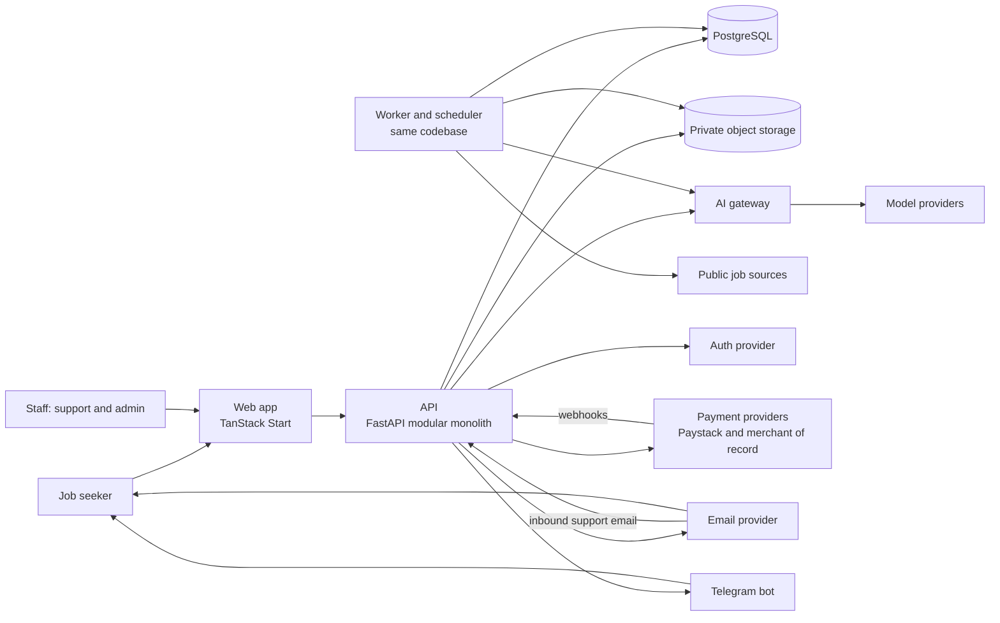
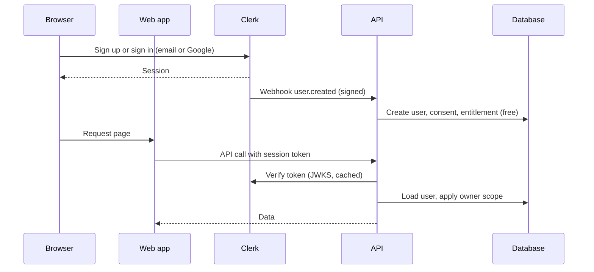
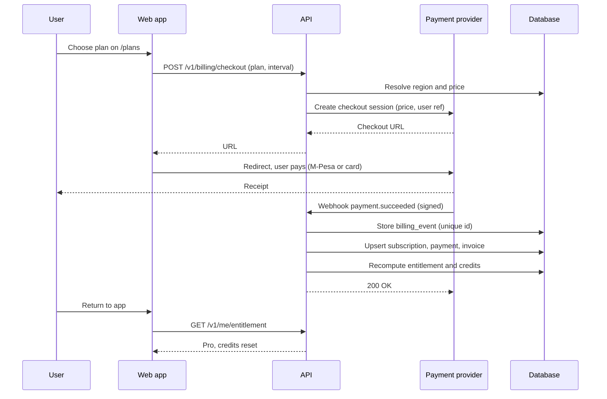
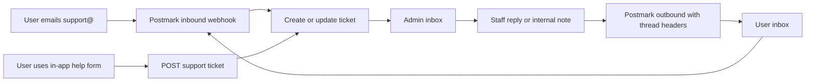

# Jobmigo technical design

Status: draft for review, 2026-11-06. Companion documents: `database-design.md`
(data), `ai-workflows.md` (AI), `reference-study.md` (competitors).

Items marked **Verify** rest on facts we could only partly confirm from public
sources and must be checked before we commit.

## 1. Purpose and scope

Jobmigo is an AI job-application assistant. It finds live jobs, evaluates fit,
tailors truthful CVs, checks that a CV is reachable by hiring systems, helps reach
a human, and tracks follow-ups, so applications do not vanish into the ghost
pipeline. This document describes how the system works: architecture, backend,
authentication, billing and localisation, email, support, the admin panel, data,
security and operations.

**Non-goals for the first release:** microservices, auto-applying, scraping sites
that forbid it, native mobile apps, enterprise SSO, multi-region active-active.

## 2. System context

## 3. Architecture overview

One deployable backend (modular monolith) plus the web app. Background work runs
in a second process from the same codebase.

| Container | Technology | Responsibility |
|---|---|---|
| `web` | TanStack Start, React, TypeScript, Tailwind | Public site, app UI, admin UI. Renders pages, calls the API. No business logic, no database access, no secrets |
| `api` | Python, FastAPI, SQLAlchemy, Alembic | All business logic, validation, authorisation, billing logic, webhooks |
| `worker` | Same code as `api` | Background jobs, schedules, retries, email sending, AI calls, job-source ingestion |
| `db` | PostgreSQL | System of record, job queue, audit trail |
| `storage` | S3-compatible private bucket | CVs, generated documents, invoice PDFs |

### Backend modules

Each module owns its models, schemas, service functions and routes. A module calls
another only through that module's service functions, never its tables.

| Module | Owns |
|---|---|
| `identity` | Users, consent, data requests, staff and roles (identity itself lives in the auth provider) |
| `profiles` | CV upload and parsing, profile, tracks |
| `jobs` | Sources, adapters, ingestion, dedupe, verification, legitimacy |
| `evaluation` | Screening, fit evaluation, evidence |
| `documents` | Tailored CV and letters, fact check, reachability check, export |
| `applications` | Pipeline, follow-ups, ghost watch |
| `outreach` | Public contacts, drafted notes, send log |
| `progress` | Quests, streaks, levels, badges |
| `ai` | The AI gateway, prompts, cache, usage ledger |
| `billing` | Plans, regional prices, subscriptions, payments, entitlements, credits |
| `notifications` | In-app, Telegram, email dispatch, templates |
| `support` | Tickets, messages, canned replies |
| `admin` | Staff-only operations, RBAC, audit log, feature flags, announcements |
| `platform` | Config, logging, errors, jobs, health, i18n helpers |

### Layering inside a module

routes (thin: validate, call service) -> services (business rules) -> repositories
(queries, always owner-scoped) -> models. External providers are used only through
interfaces defined in the owning module.

### Provider interfaces

Every external service sits behind a small interface so it can be swapped.

| Interface | Methods (sketch) | First implementation |
|---|---|---|
| `AuthVerifier` | `verify(token) -> Identity` | Clerk (see section 6) |
| `BillingProvider` | `create_checkout`, `change_plan`, `cancel`, `pause`, `refund`, `parse_webhook` | Paystack (Kenya), Paddle (international) |
| `EmailProvider` | `send(template, to, locale, data)`, `parse_inbound` | Postmark |
| `NotificationChannel` | `deliver(user, message)` | In-app, Telegram, email |
| `AIProvider` | `complete(task, input, schema)` | Chosen per task in config |
| `JobSourceAdapter` | `detect`, `fetch` | Public career pages and job APIs |
| `ObjectStore` | `put`, `signed_url`, `delete` | S3-compatible |

## 4. Backend behaviour

### Request lifecycle

1. The web app sends the request with the session token.
2. API middleware verifies the token through `AuthVerifier`, loads the `user`, sets a request id and the owner scope.
3. The route validates input with Pydantic and calls a service.
4. The service checks permissions and entitlements, does the work, and returns a schema.
5. Errors are typed domain errors mapped to HTTP status codes in one handler. Responses use one error shape.

### Background work

- Jobs are rows in `background_job` with status, attempts, `run_at` and a unique `idempotency_key`. Workers claim rows with `SELECT ... FOR UPDATE SKIP LOCKED`.
- Handlers are safe to run twice. Retries use exponential backoff with a maximum attempt count, then a dead state visible in the admin panel.
- A scheduler enqueues recurring work: job discovery, digest per user at 07:30 local time, ghost-watch scan, entitlement resets, data purge.
- Slow or external steps (CV parsing, AI calls, source fetches, email) always run in the worker.
- Move to Redis and Celery only when queue volume or latency demands it.

### Idempotency and retries

- Webhooks and API writes that move money or credits carry an idempotency key. Duplicate deliveries are detected by `billing_event.provider_event_id`.
- External calls have timeouts and retries. A failing source or provider degrades one feature, never the whole app.

### API style

REST over JSON, versioned under `/v1`, OpenAPI generated. The web app's typed
client is generated from the schema. Staff endpoints live under `/v1/admin`
behind a separate permission check.

## 5. Frontend architecture

- TanStack Start: file-based routes, loaders that prefetch through TanStack Query, server rendering for the public site.
- Routes: public (`/`, `/pricing`, `/signup`), onboarding, app (`/dashboard`, `/jobs`, `/applications`, `/documents`, `/outreach`, `/profile`), billing (`/plans`, `/checkout`), admin (`/admin/*`, staff only).
- Server functions are limited to web-layer concerns (session cookie handling). Business logic stays in the API.
- Styling from the locked tokens in `prototypes/theme.css`. Motion respects reduced-motion settings.

## 6. Authentication and authorisation

**Choice: Clerk** as the managed identity provider for v1.

- Why: complete sign-up and sign-in UI (email and Google), email verification, password reset, MFA, session handling, a TanStack Start SDK, and a free tier that comfortably covers early volume. Newer sources put the free tier at 50,000 monthly retained users, older ones at 10,000. **Verify** current limits and pricing.
- Alternatives kept in view: WorkOS AuthKit (very large free tier, strong for B2B later), Better Auth (open source, self-hosted, no vendor fee, but we would own security and it runs in the TypeScript layer).
- Lock-in control: we store only `user.auth_subject` and `email`. Profile and product data stay in our database. `AuthVerifier` isolates the provider, so a move is a migration of identities, not of data.

### Flow

### Authorisation

- **Users:** every query is scoped by the authenticated `user_id`, taken from the verified session, never from client input.
- **Entitlements:** plan features and credit balance are checked in services before any paid or AI action.
- **Staff:** roles `support`, `finance`, `admin`, `owner` with explicit permissions (`users.read`, `tickets.reply`, `billing.refund`, `pricing.write`, `flags.write`). Staff accounts require MFA and are provisioned by an owner.
- Staff endpoints are separate, permission-checked, rate-limited and write an audit row for every read or change of user data.

## 7. Subscriptions, billing and payments

### Principles

- Two payment rails behind one `BillingProvider` interface, chosen by the user's **billing region**, not just IP.
- Our database holds the truth about what a user is entitled to. Providers hold the money.
- Webhooks are the only way subscription state changes. We never trust the browser redirect.
- No card or mobile-money credentials touch our servers.

### Providers by region

| Region | Currency | Provider | Methods | Notes |
|---|---|---|---|---|
| Kenya (`KE`) | KES | **Paystack** | M-Pesa, cards (Visa, Mastercard, Amex), Apple Pay | Live for Kenyan merchants, settles in KES and USD |
| International (`INT`) | USD | **Paddle** as merchant of record (fallback: Polar) | Cards, wallets, local methods | Merchant of record handles global sales tax and VAT |

Why not Stripe directly: sources indicate Stripe business accounts are not
directly available in Kenya (access is through Paystack's extended network, or an
offshore company). **Verify** on Stripe's own country page before deciding.

Paddle lists Kenya as a supported country, but payout rails to Kenyan sellers were
not confirmed in official documentation. **Verify** payout method, fees, minimum
payout and currency with Paddle before committing. Polar lists Kenya as a payout
country (via Stripe Connect Express). **Verify** the same for Polar.

### M-Pesa and recurring billing

Paystack's support material says M-Pesa cannot be used for automatic recurring
payments, while cards can. **Verify** current behaviour. Design for it:

- **Cards (KES or USD):** automatic renewal through provider subscriptions.
- **M-Pesa in Kenya:** `renewal_mode = manual_mpesa`. Each period is prepaid. Three days before expiry the user gets an email, Telegram message and in-app prompt with a one-tap M-Pesa STK push. If unpaid, the subscription moves to `past_due` with a grace period, then back to Free. Nothing is lost.
- **Later:** Safaricom's Daraja M-Pesa Ratiba (standing orders) can enable true M-Pesa auto-renew. It is a commercial API that needs Safaricom approval and a paybill or till. Revisit when Kenyan volume justifies it.

### Regional pricing

- A **price book**: `plan` x `region` x `interval` -> `price` (amount in minor units, currency, provider price id, effective dates). Kenya has its own prices in KES. Prices are never computed by converting a USD figure at runtime.
- Prices are versioned. A change creates a new row with `active_from`; existing subscribers keep their price until they change plan (grandfathering is a policy flag).
- Admins edit prices in the admin panel (finance permission, audited). Publishing creates or syncs the provider price object.
- Price levels are business decisions still to be made. Suggested approach to test: set Kenya prices from local willingness to pay and the M-Pesa fee structure, not by currency conversion, and compare conversion per region.
- Abuse control: region is set from the billing country and payment method country. A user cannot get Kenyan pricing with an international card.

### Checkout and subscription flow

### Entitlements and credits

- `entitlement` is derived state: plan features, credit balance and quotas for the current period.
- Credits are consumed by AI workflows (see `ai-workflows.md`); every call writes a `usage_event`. Cached results cost nothing.
- Credits reset at period start. Unused credits do not roll over (policy, adjustable).
- Free plan has fixed quotas (for example a daily job-match cap). Limits are hypotheses to test.
- If a webhook is missed, an hourly reconciliation job compares provider state with ours and repairs drift.

### Dunning, pauses, refunds, cancellation

- Failed card renewals: retry per provider schedule, email the user, `past_due` with a grace period, then downgrade.
- Pause for up to two months: keeps profile and history, suspends paid features.
- Cancel any time: access continues to period end. Refunds follow the published policy and are issued by finance staff from the admin panel through the provider, with an audit row.
- Invoices: we issue Kenyan invoices for Paystack payments (with VAT when registered); the merchant of record issues international invoices.

### Tax

Kenya VAT on digital services and KRA registration obligations apply to Kenyan
sales. **Verify** thresholds and filing duties with an accountant. The merchant
of record handles international sales tax and VAT.

## 8. Localisation

Localisation covers language, currency, payment methods, tax, time and email.

| Concern | Approach |
|---|---|
| UI language | i18n framework with message catalogs. English first, Swahili next. Keys from day one, no hard-coded copy |
| Region vs language | Independent settings: a user in Kenya can use English or Swahili; language never changes the price |
| Currency | Region sets the currency (KES, USD). All amounts formatted with `Intl.NumberFormat` using the user's locale |
| Prices | Region-specific price book (section 7), not currency conversion |
| Payment methods | Region decides what checkout shows: M-Pesa and cards in Kenya, cards and wallets internationally |
| Tax | Tax rate and inclusive or exclusive display come from the region record |
| Time | Timezone stored per user. Default `Africa/Nairobi` for Kenya. The daily digest and reminders send at local time |
| Email and Telegram | Templates per locale, with an English fallback |
| Job data | Salaries and locations keep their original currency. Display conversion is informational only |
| Legal | Terms, privacy policy and invoice wording per region |

## 9. Email service

**Choice: Postmark** for transactional and inbound email, using separate message
streams for transactional and broadcast mail.

- Why: strong deliverability record, simple inbound parsing (needed for the support inbox), clear bounce and spam handling. Sources agree Postmark leads on deliverability and inbound, Resend on developer experience, and Amazon SES on cost at high volume. Resend may lack inbound parsing (**Verify**).
- Cost note: Postmark is priced higher per message than SES. At our early volume the difference is small. Revisit SES if volume grows past what justifies the premium.
- Behind `EmailProvider`, so a switch to SES or Resend is contained.

| Email | Stream | Examples |
|---|---|---|
| Account | Transactional | Verification and reset (if sent by us), welcome |
| Billing | Transactional | Receipt, renewal reminder, M-Pesa renewal prompt, failed payment |
| Product | Transactional | Daily digest, strong-fit alert, ghost-watch nudge |
| Support | Transactional and inbound | Ticket confirmation, staff replies, inbound to `support@` |
| Marketing | Broadcast | Waitlist and product updates, with one-click unsubscribe and consent check |

Setup: dedicated sending domain with SPF, DKIM and DMARC; webhooks for bounces,
spam complaints and delivery update `email_log` and suppress bad addresses.

## 10. Notifications

- Channels: in-app, Telegram bot, email. Each user chooses channels and quiet hours.
- A notification is created once, then delivered per channel by worker jobs with retries.
- Telegram: users link their account with a one-time code. The digest sends at local 07:30.
- Marketing consent is separate from product notifications.

## 11. AI gateway

Summarised here; full map in `ai-workflows.md`. One interface for all model
calls. Task name selects model and prompt (cheap model for screening, strong
model for evaluation and drafting), prompts are versioned, outputs validated
against schemas, results cached by content hash, and every call writes a
`usage_event` with cost. Dealbreaker gates and caching run before any model call.

## 12. Admin panel and support desk

Part of the same web app under `/admin`, backed by the `admin` and `support`
modules. Staff only, MFA required, every action audited.

### Admin areas

| Area | What staff can do | Permission |
|---|---|---|
| Overview | Signups, active users, MRR by currency, AI cost against revenue, queue and webhook health | `overview.read` |
| Users | Search, view profile summary and plan, adjust credits (with reason), suspend or restore, start data export or deletion | `users.read`, `users.write` |
| Subscriptions | See status and payments, retry, pause, extend, refund through the provider | `billing.read`, `billing.refund` |
| Pricing and regions | Edit the price book, regions, currencies, payment methods, tax rates, effective dates | `pricing.write` |
| Support inbox | Read, assign, reply, add internal notes, tag, use canned replies, solve tickets | `tickets.*` |
| Job sources | Adapter health, last run, errors, run now, disable | `jobs.write` |
| AI and costs | Cost per workflow and per user, model routing, kill switches, prompt versions | `ai.write` |
| Feature flags and announcements | Roll out features by plan, region or percentage; banner messages | `flags.write` |
| Operations | Failed background jobs, webhook failures, email bounces, replay events | `ops.write` |
| Audit log | Search who did what, when and why | `audit.read` |

### Support desk

- Tickets link to the user, plan and recent billing events so staff see context without hunting.
- Replies keep the email thread (Message-Id, In-Reply-To). Internal notes never leave the system.
- Canned replies support localisation. First-response and resolution times are tracked.
- A support provider (Crisp or Help Scout) is the alternative if the in-house inbox outgrows its value. The `support` module keeps that option open.

### Safeguards

- **Least privilege:** support staff cannot refund or change prices.
- **View as user:** read-only, requires a ticket reference, time-limited, and is audited. Staff never see passwords or payment credentials, and CV text is shown only when the ticket needs it.
- **Dual control (optional):** refunds above a threshold need a second approver.
- The audit log is append-only.

## 13. Data, tenancy, security and privacy

- **Tenancy:** row-level `user_id` scoping in the repository layer, plus Postgres Row Level Security as defence in depth. See `database-design.md`.
- **Storage:** private bucket, signed URLs with short expiry, virus scan on upload, file type and size limits.
- **Secrets:** environment variables per environment, never in code or logs. Rotate provider keys on schedule.
- **Transport and web:** HTTPS only, secure cookies, CSRF protection for cookie sessions, strict CORS, security headers, rate limits per user and IP.
- **Webhooks:** verify signatures, reject replays, process idempotently.
- **PII in logs:** none. Logs carry ids and request ids, not CV text or contact details.
- **AI data handling:** prompts contain only the user's own data, no other user's. Provider settings must opt out of training on our data. Record this in the provider contract.
- **Privacy law:** Kenya Data Protection Act applies to Kenyan users (registration with the Office of the Data Protection Commissioner as a data controller or processor may be required) and GDPR to EU users. **Verify** with a lawyer. Required product features: consent records, export, deletion, clear privacy policy.
- **Backups:** automated daily database backups, point-in-time recovery if the host offers it, and a restore drill before launch.
- **Admin hardening:** MFA, role separation, audit, optional IP allow-list.

## 14. Observability and operations

- Structured JSON logs with request id and user id (no personal text).
- Error tracking (Sentry or equivalent) for web, api and worker.
- Metrics: request latency, job queue depth and age, webhook failures, AI cost per workflow, email bounce rate, payment success rate by region and method.
- Alerts: failed webhooks, stuck queue, error spike, AI daily spend over budget.
- Health: `GET /healthz` (process) and `GET /readyz` (database, storage).

## 15. Environments and deployment

- Environments: local (`docker compose`), staging, production. Provider test modes in non-production.
- Containers: `web`, `api`, `worker`, Postgres, object storage.
- Hosting: one small cloud platform with managed Postgres. Pick a region close to Kenyan users that offers managed Postgres (for example AWS Cape Town or a Johannesburg region). **Verify** latency and availability when choosing.
- CI: lint, type check, tests, build; migrations run before the app starts; deploy on merge to main with a manual production gate.
- Config by environment variable names: `DATABASE_URL`, `STORAGE_*`, `AUTH_*`, `PAYSTACK_SECRET_KEY`, `PADDLE_API_KEY`, `POSTMARK_SERVER_TOKEN`, `POSTMARK_INBOUND_SECRET`, `TELEGRAM_BOT_TOKEN`, `AI_PROVIDER_KEYS`, `SENTRY_DSN`.

## 16. Cost drivers

No figures are promised here. Watch these, and let the admin overview show them:
AI inference per active user (the largest variable cost), email volume, auth
provider tier, payment fees (Paystack and merchant of record fees differ by
method and region), hosting and database, object storage, error tracking.

## 17. Decisions and open questions

| Decision | Choice | Status |
|---|---|---|
| Architecture | Modular monolith, one worker process | Decided |
| Auth | Clerk behind `AuthVerifier` | Proposed. **Verify** free-tier limits |
| Email | Postmark, two streams, inbound for support | Proposed |
| Kenya billing | Paystack (cards auto-renew, M-Pesa prepaid with renewal prompt) | Proposed. **Verify** M-Pesa recurring |
| International billing | Paddle as merchant of record, Polar as fallback | Proposed. **Verify** Kenyan payout |
| Support desk | In-house in the admin panel, Postmark inbound | Proposed |
| Languages | English first, Swahili next | Proposed |
| Pricing levels | Kenya and international prices | Open: business decision |
| Hosting region and provider | Close to Kenya, managed Postgres | Open |
| Company and tax setup (VAT, KRA, ODPC) | Needs accountant and lawyer | Open |

## 18. Impact on the build plan

New or expanded work (added to `blueprint/build-plan.md`):

- Foundation: auth integration with Clerk, `AuthVerifier`, staff roles and the audit log skeleton.
- Billing and entitlements: regional price book, Paystack and Paddle providers, webhooks, entitlements, M-Pesa renewal prompts, dunning, invoices.
- Localisation: i18n catalogs, locale and timezone settings, regional formatting.
- Email: Postmark provider, templates, bounce handling, inbound support.
- Admin panel and support desk.
