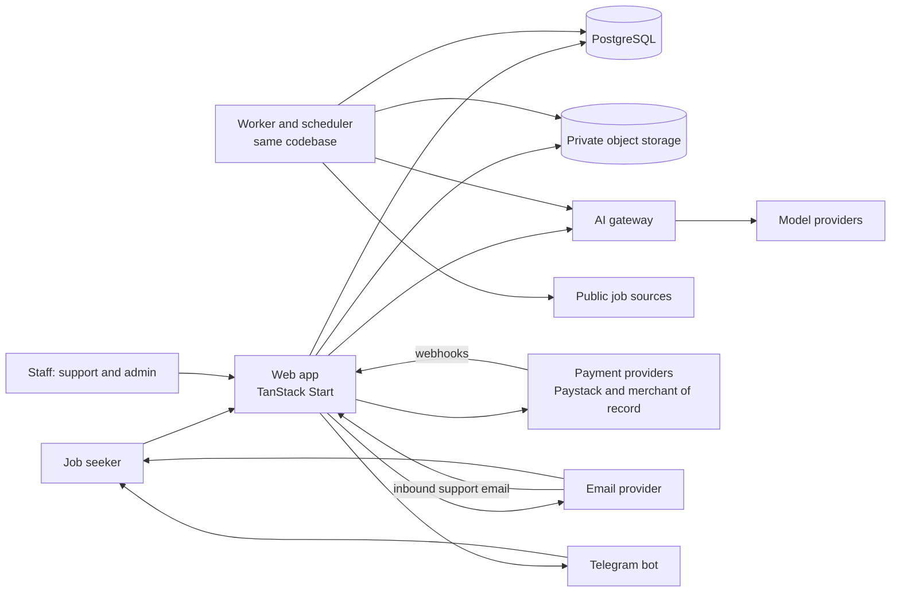
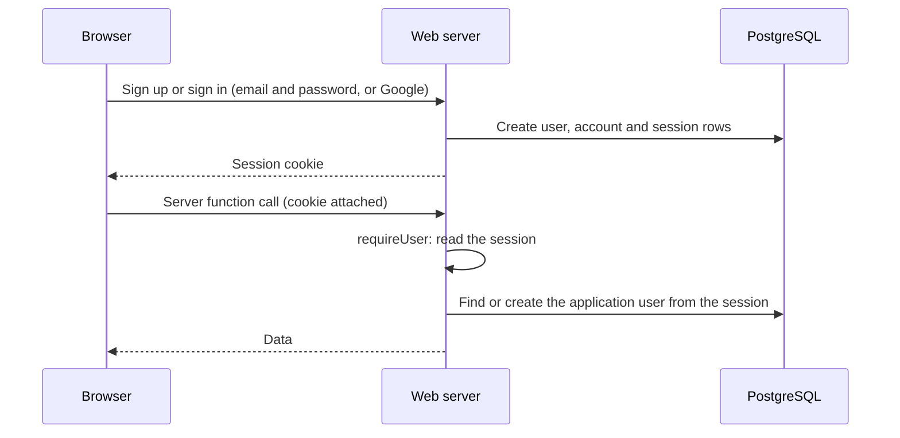
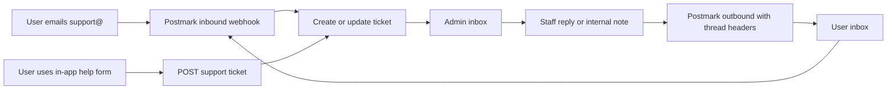

# Jobmigo technical design

Status: draft for review, 2026-11-06. Companion documents: `database-design.md`
(data), `ai-workflows.md` (AI), `reference-study.md` (competitors).

Items marked **Verify** rest on facts we could only partly confirm from public
sources and must be checked before we commit.

## 1. Purpose and scope

Jobmigo is an AI job-application assistant. It finds live jobs, evaluates fit,
tailors truthful CVs, checks that a CV is reachable by hiring systems, helps reach
a human, and tracks follow-ups, so applications do not vanish into the ghost
pipeline. This document describes how the system works: architecture, backend,
authentication, billing and localisation, email, support, the admin panel, data,
security and operations.

**Non-goals for the first release:** microservices, auto-applying, scraping sites
that forbid it, native mobile apps, enterprise SSO, multi-region active-active.

## 2. System context

## 3. Architecture overview

One TypeScript app (modular monolith) built on TanStack Start: the UI and the
server code live together. Background work runs in a second Node process from the
same codebase.

| Container | Technology | Responsibility |
|---|---|---|
| `web` | TanStack Start, React, TypeScript, Tailwind, Better Auth, Drizzle | Public site, app UI, admin UI, and all server code: sign-up, sign-in and sessions (Better Auth), business logic, validation, authorisation, billing logic, webhooks, in `web/src/server/` |
| `worker` | Same code as `web` (separate Node process) | Background jobs, schedules, retries, email sending, AI calls, job-source ingestion |
| `db` | PostgreSQL | System of record, job queue, audit trail |
| `storage` | S3-compatible private bucket | CVs, generated documents, invoice PDFs |

### Backend modules

Each module owns its tables, schemas, service functions and server functions. A module calls
another only through that module's service functions, never its tables.

| Module | Owns |
|---|---|
| `identity` | Application users, consent, data requests, staff and roles. Sign-in itself lives in Better Auth (web server) |
| `profiles` | CV upload and parsing, profile, tracks |
| `jobs` | Sources, adapters, ingestion, dedupe, verification, legitimacy |
| `evaluation` | Screening, fit evaluation, evidence |
| `documents` | Tailored CV and letters, fact check, reachability check, export |
| `applications` | Pipeline, follow-ups, ghost watch |
| `outreach` | Public contacts, drafted notes, send log |
| `progress` | Quests, streaks, levels, badges |
| `ai` | The AI gateway, prompts, cache, usage ledger |
| `billing` | Plans, regional prices, subscriptions, payments, entitlements, credits |
| `notifications` | In-app, Telegram, email dispatch, templates |
| `support` | Tickets, messages, canned replies |
| `admin` | Staff-only operations, RBAC, audit log, feature flags, announcements |
| `platform` | Config, logging, errors, jobs, health, i18n helpers |

### Layering inside a module

routes (thin: validate, call service) -> services (business rules) -> repositories
(queries, always owner-scoped) -> models. External providers are used only through
interfaces defined in the owning module.

### Provider interfaces

Every external service sits behind a small interface so it can be swapped.

| Interface | Methods (sketch) | First implementation |
|---|---|---|
| `AuthProvider` | `getSession(headers) -> { user: { id, email, name } } or null` | Better Auth sessions (see section 6) |
| `BillingProvider` | `create_checkout`, `change_plan`, `cancel`, `pause`, `refund`, `parse_webhook` | Paystack (Kenya), Paddle (international) |
| `EmailProvider` | `send(template, to, locale, data)`, `parseInbound` | Resend first; Postmark or another later |
| `NotificationChannel` | `deliver(user, message)` | In-app, Telegram, email |
| `AIProvider` | `complete(task, input, schema)` | Chosen per task in config |
| `JobSourceAdapter` | `detect`, `fetch` | Public career pages and job APIs |
| `ObjectStore` | `put`, `signed_url`, `delete` | S3-compatible |

## 4. Backend behaviour

### Request lifecycle

1. The browser calls a server function or route with its session cookie.
2. Request middleware assigns a request id; `requireUser` reads the session and loads the `user`.
3. The function validates input and calls a service, always scoped by the user id.
4. The service checks permissions and entitlements, does the work, and returns typed data.
5. Errors are typed domain errors mapped to one `{ code, message }` shape; unexpected errors are logged without personal data and returned as a generic error.

### Background work

- Jobs are rows in `background_job` with status, attempts, `run_at` and a unique `idempotency_key`. Workers claim rows with `SELECT ... FOR UPDATE SKIP LOCKED`.
- Handlers are safe to run twice. Retries use exponential backoff with a maximum attempt count, then a dead state visible in the admin panel.
- A scheduler enqueues recurring work: job discovery, digest per user at 07:30 local time, ghost-watch scan, entitlement resets, data purge.
- Slow or external steps (CV parsing, AI calls, source fetches, email) always run in the worker.
- Move to Redis and Celery only when queue volume or latency demands it.

### Idempotency and retries

- Webhooks and API writes that move money or credits carry an idempotency key. Duplicate deliveries are detected by `billing_event.provider_event_id`.
- External calls have timeouts and retries. A failing source or provider degrades one feature, never the whole app.

### Server interface style

Server functions (typed end to end, no generated client) serve the app UI, and
server routes serve webhooks, health checks and any public endpoint. Both return
the stable `{ code, message }` error shape. Staff functions sit behind a separate
permission check.

## 5. Frontend architecture

- TanStack Start: file-based routes, loaders that prefetch through TanStack Query, server rendering for the public site.
- Routes: public (`/`, `/pricing`, `/signup`), onboarding, app (`/dashboard`, `/jobs`, `/applications`, `/documents`, `/outreach`, `/profile`), billing (`/plans`, `/checkout`), admin (`/admin/*`, staff only).
- The web server also hosts Better Auth (`/api/auth/*`). Business logic lives in `web/src/server/` modules, called from thin server functions and routes; client components never import it.
- Styling from the locked tokens in `prototypes/theme.css`. Motion respects reduced-motion settings.

## 6. Authentication and authorisation

**Choice: Better Auth** (open source, TypeScript), running inside the TanStack Start
web server, with its data in our own PostgreSQL database.

- Why: no per-user fee and no external account or vendor lock-in, our users live in our database, email and password plus Google sign-in out of the box, a plugin for two-factor authentication (staff), and first-class TanStack Start support.
- Trade-offs accepted: we own the security configuration (password rules, rate limits, cookie settings), keep it patched, and build the sign-in screens ourselves. Email verification and password reset need the email service (feature 24).
- Alternatives kept in view: Clerk (managed UI and a free tier, but per-user pricing later and vendor lock-in) and WorkOS AuthKit.
- Portability: server code depends only on the `AuthProvider` shape (`getSession`). The application `user` row stores `auth_subject` (the Better Auth user id) and email; everything else about people stays in our tables.

### How identity reaches the app

Better Auth owns four tables (`auth_user`, `auth_session`, `auth_account`,
`auth_verification`) in the same database. Drizzle migrations create them like every
other table. The rest of the server code never reads them directly. It asks for the
session and maps it to the application `user` row.

- `requireUser` is the only source of the acting user. It creates the `user` row on first use (concurrent first requests create one row), refuses suspended or deleted users, and refuses an email already owned by another identity.
- Account linking is disabled until email verification exists (feature 24), so a pre-registered unverified email cannot be taken over by a later social sign-in.

### Authorisation

- **Users:** every query is scoped by the authenticated `user_id`, taken from the verified session, never from client input.
- **Entitlements:** plan features and credit balance are checked in services before any paid or AI action.
- **Staff:** roles `support`, `finance`, `admin`, `owner` with explicit permissions (`users.read`, `tickets.reply`, `billing.refund`, `pricing.write`, `flags.write`). Staff accounts will require two-factor authentication (Better Auth plugin) and are provisioned by an owner.
- Staff functions are separate, permission-checked, rate-limited and write an audit row for every read or change of user data.

### Security settings we own

Password minimum length 8 and a breached-password check when available, rate limits
on sign-in and sign-up, secure and `HttpOnly` cookies, CSRF protection, a long random
`BETTER_AUTH_SECRET` per environment, trusted origins limited to our domains, and a
separate database role for migrations once deployed.

## 7. Subscriptions, billing and payments

### Principles

- Two payment rails behind one `BillingProvider` interface, chosen by the user's **billing region**, not just IP.
- Our database holds the truth about what a user is entitled to. Providers hold the money.
- Webhooks are the only way subscription state changes. We never trust the browser redirect.
- No card or mobile-money credentials touch our servers.

### Providers by region

| Region | Currency | Provider | Methods | Notes |
|---|---|---|---|---|
| Kenya (`KE`) | KES | **Paystack** | M-Pesa, cards (Visa, Mastercard, Amex), Apple Pay | Live for Kenyan merchants, settles in KES and USD |
| International (`INT`) | USD | **Paddle** as merchant of record (fallback: Polar) | Cards, wallets, local methods | Merchant of record handles global sales tax and VAT |

Why not Stripe directly: sources indicate Stripe business accounts are not
directly available in Kenya (access is through Paystack's extended network, or an
offshore company). **Verify** on Stripe's own country page before deciding.

Paddle lists Kenya as a supported country, but payout rails to Kenyan sellers were
not confirmed in official documentation. **Verify** payout method, fees, minimum
payout and currency with Paddle before committing. Polar lists Kenya as a payout
country (via Stripe Connect Express). **Verify** the same for Polar.

### M-Pesa and recurring billing

Paystack's support material says M-Pesa cannot be used for automatic recurring
payments, while cards can. **Verify** current behaviour. Design for it:

- **Cards (KES or USD):** automatic renewal through provider subscriptions.
- **M-Pesa in Kenya:** `renewal_mode = manual_mpesa`. Each period is prepaid. Three days before expiry the user gets an email, Telegram message and in-app prompt with a one-tap M-Pesa STK push. If unpaid, the subscription moves to `past_due` with a grace period, then back to Free. Nothing is lost.
- **Later:** Safaricom's Daraja M-Pesa Ratiba (standing orders) can enable true M-Pesa auto-renew. It is a commercial API that needs Safaricom approval and a paybill or till. Revisit when Kenyan volume justifies it.

### Regional pricing

- A **price book**: `plan` x `region` x `interval` -> `price` (amount in minor units, currency, provider price id, effective dates). Kenya has its own prices in KES. Prices are never computed by converting a USD figure at runtime.
- Prices are versioned. A change creates a new row with `active_from`; existing subscribers keep their price until they change plan (grandfathering is a policy flag).
- Admins edit prices in the admin panel (finance permission, audited). Publishing creates or syncs the provider price object.
- Price levels are business decisions still to be made. Suggested approach to test: set Kenya prices from local willingness to pay and the M-Pesa fee structure, not by currency conversion, and compare conversion per region.
- Abuse control: region is set from the billing country and payment method country. A user cannot get Kenyan pricing with an international card.

### Checkout and subscription flow

### Entitlements and credits

- `entitlement` is derived state: plan features, credit balance and quotas for the current period.
- Credits are consumed by AI workflows (see `ai-workflows.md`); every call writes a `usage_event`. Cached results cost nothing.
- Credits reset at period start. Unused credits do not roll over (policy, adjustable).
- Free plan has fixed quotas (for example a daily job-match cap). Limits are hypotheses to test.
- If a webhook is missed, an hourly reconciliation job compares provider state with ours and repairs drift.

### Dunning, pauses, refunds, cancellation

- Failed card renewals: retry per provider schedule, email the user, `past_due` with a grace period, then downgrade.
- Pause for up to two months: keeps profile and history, suspends paid features.
- Cancel any time: access continues to period end. Refunds follow the published policy and are issued by finance staff from the admin panel through the provider, with an audit row.
- Invoices: we issue Kenyan invoices for Paystack payments (with VAT when registered); the merchant of record issues international invoices.

### Tax

Kenya VAT on digital services and KRA registration obligations apply to Kenyan
sales. **Verify** thresholds and filing duties with an accountant. The merchant
of record handles international sales tax and VAT.

## 8. Localisation

Localisation covers language, currency, payment methods, tax, time and email.

| Concern | Approach |
|---|---|
| UI language | i18n framework with message catalogs. English first, Swahili next. Keys from day one, no hard-coded copy |
| Region vs language | Independent settings: a user in Kenya can use English or Swahili; language never changes the price |
| Currency | Region sets the currency (KES, USD). All amounts formatted with `Intl.NumberFormat` using the user's locale |
| Prices | Region-specific price book (section 7), not currency conversion |
| Payment methods | Region decides what checkout shows: M-Pesa and cards in Kenya, cards and wallets internationally |
| Tax | Tax rate and inclusive or exclusive display come from the region record |
| Time | Timezone stored per user. Default `Africa/Nairobi` for Kenya. The daily digest and reminders send at local time |
| Email and Telegram | Templates per locale, with an English fallback |
| Job data | Salaries and locations keep their original currency. Display conversion is informational only |
| Legal | Terms, privacy policy and invoice wording per region |

## 9. Email service

**Waitlist mail (feature 28a):** `web/src/server/mail.ts` defines `EmailProvider` with a Resend implementation (one `fetch` call, no SDK) and a console provider for local development. Waitlist emails use double opt-in with `List-Unsubscribe`.

**Choice: Resend first** (free tier, transactional email, behind the `EmailProvider`
interface). Postmark or another provider can take over inbound support mail and
broadcast later, with separate streams for transactional and broadcast mail.

- Why: strong deliverability record, simple inbound parsing (needed for the support inbox), clear bounce and spam handling. Sources agree Postmark leads on deliverability and inbound, Resend on developer experience, and Amazon SES on cost at high volume. Resend may lack inbound parsing (**Verify**).
- Cost note: Postmark is priced higher per message than SES. At our early volume the difference is small. Revisit SES if volume grows past what justifies the premium.
- Behind `EmailProvider`, so a switch to SES or Resend is contained.

| Email | Stream | Examples |
|---|---|---|
| Account | Transactional | Verification and reset (if sent by us), welcome |
| Billing | Transactional | Receipt, renewal reminder, M-Pesa renewal prompt, failed payment |
| Product | Transactional | Daily digest, strong-fit alert, ghost-watch nudge |
| Support | Transactional and inbound | Ticket confirmation, staff replies, inbound to `support@` |
| Marketing | Broadcast | Waitlist and product updates, with one-click unsubscribe and consent check |

Setup: dedicated sending domain with SPF, DKIM and DMARC; webhooks for bounces,
spam complaints and delivery update `email_log` and suppress bad addresses.

## 10. Notifications

- Channels: in-app, Telegram bot, email. Each user chooses channels and quiet hours.
- A notification is created once, then delivered per channel by worker jobs with retries.
- Telegram: users link their account with a one-time code. The digest sends at local 07:30.
- Marketing consent is separate from product notifications.

## 11. AI gateway

Summarised here; full map in `ai-workflows.md`. One interface for all model
calls. Task name selects model and prompt (cheap model for screening, strong
model for evaluation and drafting), prompts are versioned, outputs validated
against schemas, results cached by content hash, and every call writes a
`usage_event` with cost. Dealbreaker gates and caching run before any model call.

## 12. Admin panel and support desk

Part of the same web app under `/admin`, backed by the `admin` and `support`
modules. Staff only, MFA required, every action audited.

### Admin areas

| Area | What staff can do | Permission |
|---|---|---|
| Overview | Signups, active users, MRR by currency, AI cost against revenue, queue and webhook health | `overview.read` |
| Users | Search, view profile summary and plan, adjust credits (with reason), suspend or restore, start data export or deletion | `users.read`, `users.write` |
| Subscriptions | See status and payments, retry, pause, extend, refund through the provider | `billing.read`, `billing.refund` |
| Pricing and regions | Edit the price book, regions, currencies, payment methods, tax rates, effective dates | `pricing.write` |
| Support inbox | Read, assign, reply, add internal notes, tag, use canned replies, solve tickets | `tickets.*` |
| Job sources | Adapter health, last run, errors, run now, disable | `jobs.write` |
| AI and costs | Cost per workflow and per user, model routing, kill switches, prompt versions | `ai.write` |
| Feature flags and announcements | Roll out features by plan, region or percentage; banner messages | `flags.write` |
| Operations | Failed background jobs, webhook failures, email bounces, replay events | `ops.write` |
| Audit log | Search who did what, when and why | `audit.read` |

### Support desk

- Tickets link to the user, plan and recent billing events so staff see context without hunting.
- Replies keep the email thread (Message-Id, In-Reply-To). Internal notes never leave the system.
- Canned replies support localisation. First-response and resolution times are tracked.
- A support provider (Crisp or Help Scout) is the alternative if the in-house inbox outgrows its value. The `support` module keeps that option open.

### Safeguards

- **Least privilege:** support staff cannot refund or change prices.
- **View as user:** read-only, requires a ticket reference, time-limited, and is audited. Staff never see passwords or payment credentials, and CV text is shown only when the ticket needs it.
- **Dual control (optional):** refunds above a threshold need a second approver.
- The audit log is append-only.

## 13. Data, tenancy, security and privacy

- **Tenancy:** row-level `user_id` scoping in the repository layer, plus Postgres Row Level Security as defence in depth. See `database-design.md`.
- **Storage:** private bucket, signed URLs with short expiry, virus scan on upload, file type and size limits.
- **Secrets:** environment variables per environment, never in code or logs. Rotate provider keys on schedule.
- **Transport and web:** HTTPS only, secure cookies, CSRF protection for cookie sessions, strict CORS, security headers, rate limits per user and IP.
- **Webhooks:** verify signatures, reject replays, process idempotently.
- **PII in logs:** none. Logs carry ids and request ids, not CV text or contact details.
- **AI data handling:** prompts contain only the user's own data, no other user's. Provider settings must opt out of training on our data. Record this in the provider contract.
- **Privacy law:** Kenya Data Protection Act applies to Kenyan users (registration with the Office of the Data Protection Commissioner as a data controller or processor may be required) and GDPR to EU users. **Verify** with a lawyer. Required product features: consent records, export, deletion, clear privacy policy.
- **Backups:** automated daily database backups, point-in-time recovery if the host offers it, and a restore drill before launch.
- **Admin hardening:** MFA, role separation, audit, optional IP allow-list.

## 14. Observability and operations

- Structured JSON logs with request id and user id (no personal text).
- Error tracking (Sentry or equivalent) for the app and the worker.
- Metrics: request latency, job queue depth and age, webhook failures, AI cost per workflow, email bounce rate, payment success rate by region and method.
- Alerts: failed webhooks, stuck queue, error spike, AI daily spend over budget.
- Health: `GET /healthz` (process) and `GET /readyz` (database, storage).

## 15. Environments, hosting and deployment

**Target: about 100 users within a couple of months, at the lowest sensible cost, with a clear path to grow.**

### Recommendation for the first 100 users

Run everything on **one small virtual server** with Docker Compose, put Cloudflare in front, and keep files and backups off the box.

| Piece | Choice | Why |
|---|---|---|
| Compute | One VPS, 2 vCPU, 4 GB RAM, 40 GB or more disk, running Caddy (automatic HTTPS), `web`, `worker` and PostgreSQL | One bill, one place to debug, no per-service minimums |
| Edge | Cloudflare free plan for DNS, caching of static files, DDoS protection | Free, and shields the single server |
| Files and backups | S3-compatible object storage (Cloudflare R2 or Backblaze B2) | Pennies at our size. **Verify** current free tier and fees |
| Database backups | Nightly encrypted `pg_dump` to object storage, plus the VPS provider's weekly snapshot, and a restore drill before launch | Cheap and testable |
| Deploys | CI builds images, pushes them to a registry, then `docker compose pull && up -d` over SSH (Kamal or Dokploy are alternatives) | Simple, repeatable, no platform lock-in |
| Monitoring | Sentry free tier, an uptime check, Docker logs with rotation | $0 to start |
| Region | A provider region closest to Kenya that fits the budget. Expect roughly 150 to 200 ms to Europe, which is acceptable for this app. **Verify** with a latency test | Africa regions cost more |

**VPS provider.** Candidates are Hetzner (cheapest per spec, but sources report 2026
price rises and uneven stock, **Verify** on their site), DigitalOcean, Vultr and Akamai
Linode (slightly dearer, steadier availability), and AWS Lightsail in Cape Town (best
latency to Kenya, dearer). Pick on price, stock and latency on the day. The design has
no provider-specific parts, so moving later is a redeploy.

**Why not a managed platform first.** Render, Fly.io and Railway remove server work,
but one comparison puts a small app with Postgres at roughly 35 to 65 US dollars a
month, about two to three times the VPS route. They are a fair choice if your time
is worth more than the difference. Managed Postgres is the usual first thing to buy
later (stage 2).

**What the single server handles.** 100 registered users is perhaps 30 to 60 active in
a week. That is a few requests a second at peak. Job discovery is shared across
users, so it grows with sources, not users. The slow part is AI calls, which wait on
the provider and use little CPU. We expect low CPU use on a 2 vCPU server (**Verify**
with a short load test before launch).

**Production layout (feature 28b).** The app is built with Nitro for plain Node
(`.output/server/index.mjs`) and shipped as a multi-stage Docker image that runs as a
non-root user and applies Drizzle migrations before the server starts. `deploy/` holds
the production Compose file (db, web, Caddy; only Caddy publishes ports), the Caddyfile
(automatic HTTPS, security headers, an optional Cloudflare-only guard), nightly
encrypted backups to object storage with a restore script, and `deploy.sh`, which
builds, waits for health and rolls back on failure. `docs/deploy.md` is the runbook.
`TRUST_PROXY_HEADERS=true` (the waitlist rate limit trusts `cf-connecting-ip`) is only
allowed together with `CLOUDFLARE_ONLY=true`, so a visitor cannot spoof the header.

### Environments

- Local: `docker compose`. Staging: a second small VPS or the same one on another port set, with provider test modes. Production: the VPS above.
- Config only through environment variables. Secrets never enter the repository or logs.
- Config names: `DATABASE_URL`, `STORAGE_*`, `BETTER_AUTH_SECRET`, `BETTER_AUTH_URL`, `GOOGLE_CLIENT_ID`, `GOOGLE_CLIENT_SECRET`, `PAYSTACK_SECRET_KEY`, `PADDLE_API_KEY`, `RESEND_API_KEY`, `MAIL_FROM`, `TELEGRAM_BOT_TOKEN`, `AI_PROVIDER_KEYS`, `SENTRY_DSN`.
- CI: lint, type check, tests, build; migrations run before the app starts; deploy on merge to main with a manual production gate.

## 16. Cost and scaling plan

### Monthly cost at about 100 users (estimates, US dollars)

| Item | Estimate | Notes |
|---|---|---|
| VPS | 5 to 20 | Provider and size dependent. **Verify** |
| Object storage and backups | 0 to 2 | R2 or B2 |
| Email (Resend) | 0 to 20 | Free tier covers early volume. **Verify** current limits and paid plans |
| Authentication | 0 | Better Auth is open source |
| Error tracking and uptime | 0 | Free tiers |
| Domain | about 1 | Per month equivalent |
| Telegram | 0 | |
| Payment fees | percentage of revenue | Paystack and the merchant of record charge per transaction. **Verify** rates |
| **Fixed total** | **about 10 to 40** | |
| AI inference | variable, the largest cost | Depends on credits used. Budget per user and per plan |

**AI cost control is the real cost lever.** Credits cap what each user can spend.
Dealbreaker gates and cached results run before any model call, a cheap model
screens, the strong model only handles shortlisted jobs, and research per evaluation
is capped. Plan prices should keep AI cost at a small share of revenue (a target of
25 to 30 percent is a hypothesis to test). The admin overview shows AI cost against
revenue from day one, with a daily spend alert and a kill switch.

### Scaling path

Scale in steps, triggered by measurements, not by user counts alone.

| Stage | Roughly | Setup | Typical added cost |
|---|---|---|---|
| 0 | up to 300 users | One VPS as above | baseline |
| 1 | 300 to 2,000 | Bigger VPS, or move PostgreSQL to its own server or a managed instance with point-in-time recovery, add PgBouncer | modest |
| 2 | 2,000 to 10,000 | Two `web` nodes behind a load balancer, a separate `worker` node, managed Postgres with a standby, Redis only if the queue needs it | noticeable |
| 3 | 10,000 and up | Read replica, a queue service, regional edge, autoscaling or Kubernetes only if the team and load justify it | significant |

| Signal | Threshold (starting point) | Action |
|---|---|---|
| CPU or memory | over 60 percent CPU or 75 percent memory sustained | Move up a server size |
| Database | over half the disk, or connections near the limit | Separate database server, add PgBouncer |
| Latency | Server p95 over 800 ms | Profile first, then add a node |
| Queue | oldest waiting job over 5 minutes | Move the worker to its own node, raise concurrency |
| Availability | deploys or restarts visible to users | Second app node behind a load balancer |
| AI spend | over daily budget | Tighten credits and caching, route more work to the cheap model |

**Why this scales without a rewrite.** `web` is stateless (sessions live in
the database, files in object storage), the worker pulls jobs from a table so more
workers can share it, everything runs in containers configured by environment
variables, and every provider is behind an interface.

## 17. Decisions and open questions

| Decision | Choice | Status |
|---|---|---|
| Architecture | Modular monolith, one worker process | Decided |
| Stack | TypeScript end to end: TanStack Start, Drizzle, Better Auth, Vitest | Decided |
| Auth | Better Auth in the web server, sessions read by server functions, behind `AuthProvider` | Decided |
| Email | Resend first behind `EmailProvider`; Postmark or similar later for inbound and broadcast | Proposed |
| Kenya billing | Paystack (cards auto-renew, M-Pesa prepaid with renewal prompt) | Proposed. **Verify** M-Pesa recurring |
| International billing | Paddle as merchant of record, Polar as fallback | Proposed. **Verify** Kenyan payout |
| Support desk | In-house in the admin panel, inbound email provider chosen later | Proposed |
| Languages | English first, Swahili next | Proposed |
| Pricing levels | Kenya and international prices | Open: business decision |
| Hosting | One VPS with Docker Compose and Cloudflare to start (section 15), scale by stages (section 16) | Proposed. Pick provider and region on price, stock and latency |
| Company and tax setup (VAT, KRA, ODPC) | Needs accountant and lawyer | Open |

## 18. Impact on the build plan

New or expanded work (added to `blueprint/build-plan.md`):

- Foundation: Better Auth in the web server, the `AuthProvider` session interface, staff roles and the audit log skeleton.
- Billing and entitlements: regional price book, Paystack and Paddle providers, webhooks, entitlements, M-Pesa renewal prompts, dunning, invoices.
- Localisation: i18n catalogs, locale and timezone settings, regional formatting.
- Email: Resend provider, templates, bounce handling, inbound support.
- Admin panel and support desk.
